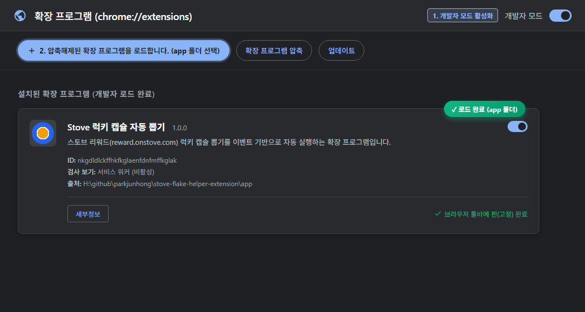
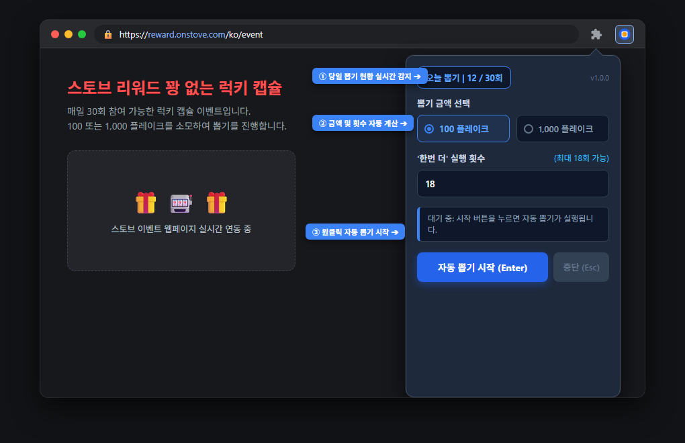
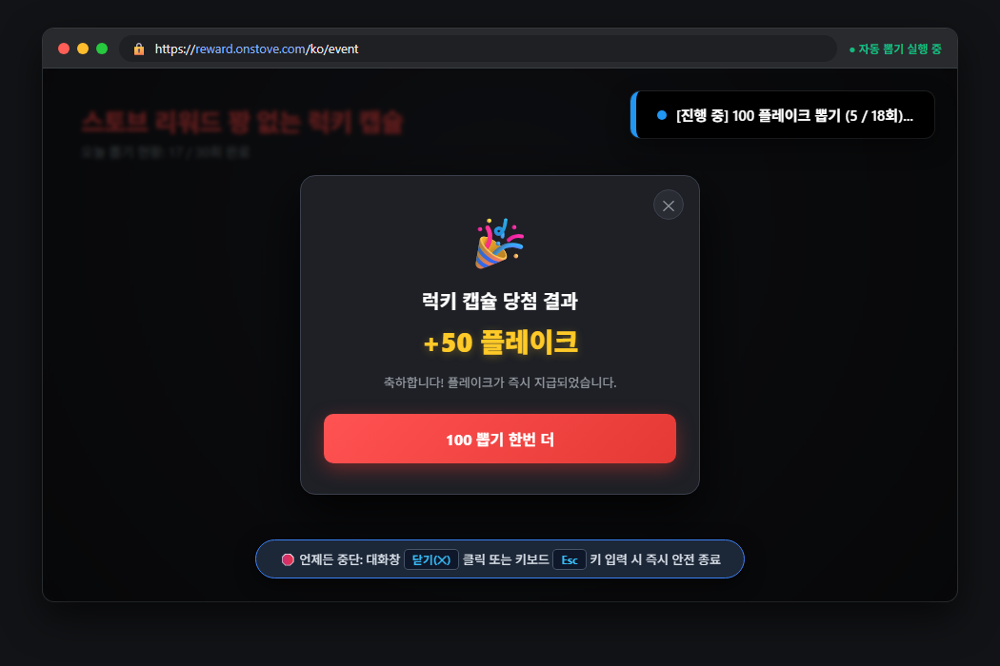

# Stove 럭키 캡슐 자동 뽑기 (Chrome Extension)

스토브 리워드 이벤트 페이지([https://reward.onstove.com/ko/event](https://reward.onstove.com/ko/event))에서 100 또는 1,000 플레이크 뽑기 및 결과 대화창의 **'한번 더'** 클릭을 이벤트 기반으로 안전하게 자동화하는 크롬 확장 프로그램입니다.

---

## 1. 설치 방법 (개발자 모드 로드)

### 1단계: 프로그램 다운로드
1. 본 GitHub 저장소 페이지 우측 상단의 초록색 **[<> Code]** 버튼을 클릭합니다.
2. 드롭다운 메뉴에서 **[Download ZIP]**을 클릭하여 소스코드 압축 파일을 다운로드합니다.
3. 다운로드한 압축 파일(`stove-flake-helper-extension-main.zip`)의 압축을 원하는 폴더에 해제합니다.
   > **주의**: 설치 완료 후 압축을 해제한 폴더(특히 `app` 폴더)를 삭제하거나 다른 경로로 이동하면 확장 프로그램이 동작하지 않습니다. 안전한 경로에 보관해 주세요.

### 2단계: 크롬 브라우저에 등록
1. 크롬 브라우저 주소창에 `chrome://extensions` 를 입력하여 확장 프로그램 관리 페이지로 이동합니다.
2. 페이지 우측 상단의 **[개발자 모드]** 토글 스위치를 켭니다.
3. 좌측 상단에 나타난 **[압축해제된 확장 프로그램을 로드합니다.]** 버튼을 클릭합니다.
4. 압축을 해제한 폴더 내의 **`app`** 폴더를 선택합니다.
5. 브라우저 우측 상단 퍼즐 모양 아이콘(확장 프로그램)을 클릭한 후, **Stove 럭키 캡슐 자동 뽑기** 옆의 핀(고정) 아이콘을 눌러 툴바에 고정합니다.

---

## 2. 사용 방법

### 1단계: 이벤트 페이지 접속 및 팝업 열기
1. 스토브 리워드 이벤트 페이지([https://reward.onstove.com/ko/event](https://reward.onstove.com/ko/event))에 접속하여 로그인합니다.
   - 확장 프로그램 설치 전부터 페이지가 열려 있었다면 `F5` 키를 눌러 새로고침합니다.
2. 브라우저 우측 상단 툴바에 고정된 **Stove 럭키 캡슐 자동 뽑기** 아이콘을 클릭합니다.

### 2단계: 금액 및 실행 횟수 설정
1. 팝업 창 상단의 **[오늘 뽑기 | X / 30회]** 뱃지를 통해 현재 진행 현황과 자동으로 계산된 **최대 가능 횟수**를 확인합니다.
2. 소모할 뽑기 금액(`100 플레이크` 또는 `1,000 플레이크`)을 선택합니다.
3. `'한번 더'` 자동 실행 횟수를 입력하거나 확인한 후 **[자동 뽑기 시작 (Enter)]** 버튼을 클릭합니다.

### 3단계: 자동 진행 및 안전 중단
1. 자동 뽑기가 시작되면 웹페이지 우측 상단에 실시간 진행 뱃지(`[진행 중] 100 플레이크 뽑기 (N / M회)...`)가 표시되며 이벤트 기반으로 안전하게 '한번 더' 클릭이 반복됩니다.
2. **진행 중 즉시 중단 방법**:
   - 웹페이지 결과 대화창의 **[닫기(✕)]** 버튼 클릭
   - 키보드의 **`Esc`** 키 입력
   - 확장 프로그램 팝업의 **[중단 (Esc)]** 버튼 클릭
   - 위 3가지 중 어느 하나라도 수행하면 진행 중인 뽑기 루프가 즉시 안전하게 멈춥니다.

---

## 3. 자동 종료 조건

다음과 같은 상황에서는 확장 프로그램이 안전하게 자동 종료됩니다:

- 당일 최대 한도(30회)에 도달하여 `오늘 30회 뽑기 완료!` 창이 나타난 경우
- 보유 플레이크가 소진되어 `보유한 플레이크가 부족합니다` 창이 나타난 경우
- 일시적인 서버 통신 오류가 발생한 경우
- 사용자가 웹페이지 모달 대화창을 닫거나 확장 프로그램 팝업의 [중단] 버튼을 누른 경우

---

## 4. 라이선스

이 프로젝트는 [Apache License 2.0](LICENSE) 라이선스를 따릅니다.
